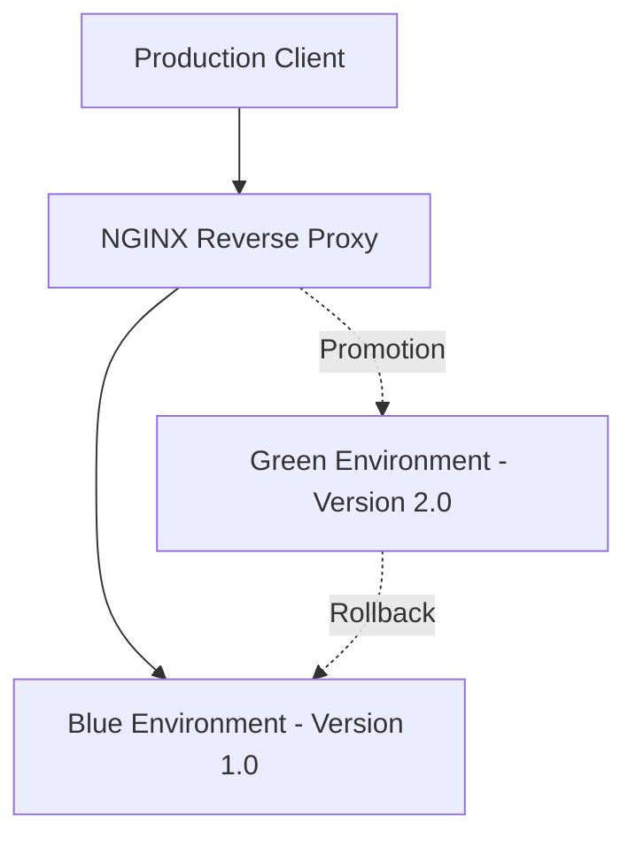

# Mini Project 2.3 — Blue/Green Deployment Strategy

**Course:** ITSD 4350 — Continuous Integration/Continuous Delivery Principles in Action Projects

## 1. Objective

Implement a Blue/Green deployment strategy that supports production promotion, health validation, and rollback using Docker Compose and NGINX.

## 2. Architecture

## 3. Deployment Workflow

1. Start the Blue, Green, and NGINX containers using Docker Compose.
2. Run `scripts/blue-green/deploy_inactive.sh` to deploy the inactive environment.
3. Validate the candidate application's health endpoint.
4. Run `scripts/blue-green/promote.sh`.
5. Enter `PROMOTE` to authorize production promotion.
6. Validate and reload NGINX.
7. Verify that production serves the promoted application.

## 4. Rollback Procedure

1. Run `scripts/blue-green/rollback.sh`.
2. Enter `ROLLBACK` to confirm.
3. Restore the previous NGINX routing configuration.
4. Validate and reload NGINX.
5. Verify that the previous production environment is healthy.

## 5. Verification Results

| Test | Result |
|---|---|
| Blue production health check | PASS |
| Green candidate health check | PASS |
| Blue-to-Green promotion | PASS |
| NGINX configuration validation | PASS |
| Green-to-Blue rollback | PASS |
| Final HTTP 200 response | PASS |

Production was successfully promoted from Blue version 1.0 to Green version 2.0 and subsequently rolled back to Blue version 1.0.

## 6. Project Files

- `infrastructure/blue-green/docker-compose.yml`
- `infrastructure/blue-green/nginx/nginx.conf`
- `scripts/blue-green/deploy_inactive.sh`
- `scripts/blue-green/promote.sh`
- `scripts/blue-green/rollback.sh`
- `docs/evidence/Amakoe_Blue_Green_Verification.txt`

## 7. Conclusion

The implementation demonstrates Blue/Green deployment using Docker Compose, NGINX, health validation, controlled production promotion, and rollback.

All reported functional tests passed in the local Docker environment. A monitored Blue-to-Green transition recorded zero failed requests.

## Final Traffic Availability Validation

The final monitored production transition recorded:

- Blue responses: 1,151
- Green responses: 94
- Failed requests: 0
- Total requests: 1,245
- Observed request success rate: 100%
- Transition observed: True

This demonstrates no failed requests during the sampled
Blue-to-Green transition. It does not guarantee that
every possible client request experienced zero interruption.

Evidence: docs/evidence/Amakoe_Traffic_Availability_Test.txt

Screenshot:
docs/evidence/screenshots/Amakoe_06_Blue_Green_Zero_Downtime_Test.png

Emergency rollback instructions:
docs/EMERGENCY_ROLLBACK.md
