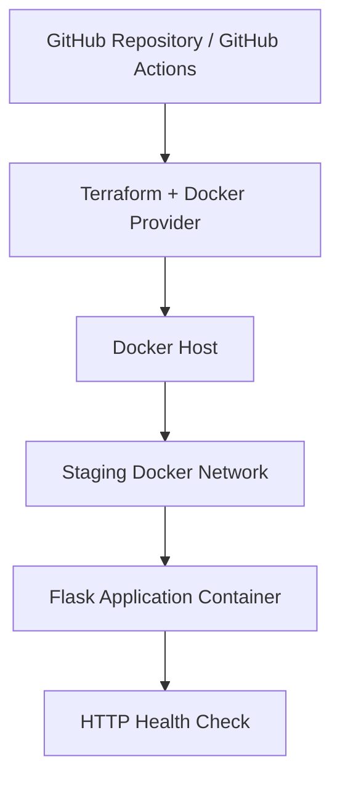

# Staging Infrastructure Architecture

## Architecture Diagram

## Infrastructure Components

- **GitHub:** Stores the source code, Terraform configuration, and automated workflows.
- **Terraform:** Provisions and manages the staging infrastructure.
- **Docker:** Runs the Flask application in an isolated container.
- **Docker Network:** Provides networking for the staging container.
- **Flask and Gunicorn:** Serve the staging application.
- **Health Check:** Verifies application availability through `/health`.

## Environment Configuration

| Setting | Value |
|---|---|
| Environment | staging |
| Container | itsd4350-staging-app |
| Network | itsd4350-staging-network |
| Docker image | itsd4350-staging-app:1.0 |
| Internal port | 8000 |
| Host binding | 127.0.0.1:8000 |
| Health endpoint | http://localhost:8000/health |

## Infrastructure Lifecycle

1. Build the staging Docker image.
2. Initialize and validate Terraform.
3. Provision the Docker network and application container.
4. Verify the application health endpoint.
5. Run Terraform again to verify idempotence.
6. Destroy the staging infrastructure.
7. Recreate the infrastructure using the same configuration.
8. Verify application health after recreation.

## Design Decisions

Terraform was selected because it supports declarative infrastructure definitions, parameterized configuration, version control, and reproducible provisioning.

Docker provides a consistent staging runtime without requiring paid cloud infrastructure.

The application is bound to the local loopback interface to avoid exposing the staging service publicly.

No database is provisioned because the current Flask application does not require persistent data storage.

GitHub Actions provides automated infrastructure provisioning and recreation testing on temporary runners. The existing Render staging deployment remains separate from this Terraform demonstration.
